# Low Noise Amplifier Layout Characterization

## S Parameter Test Bench

*Most Up-To-Date Test Bench: Schematic/LNA/LNA_Layout_Testing_S_Parameters_MkII.sch*

This testing was performed using the QUCS-S S parameter simulation utility.  It shows the linear response of the amplifier at all corners.

### Typical

| Parameter | Simulation |
|-----------|------------|
|S11|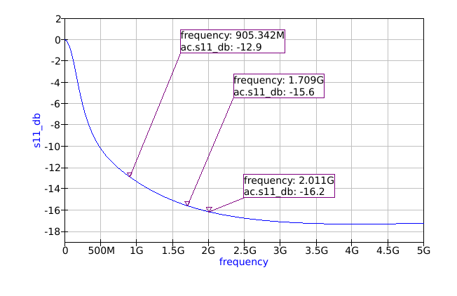|
|S12|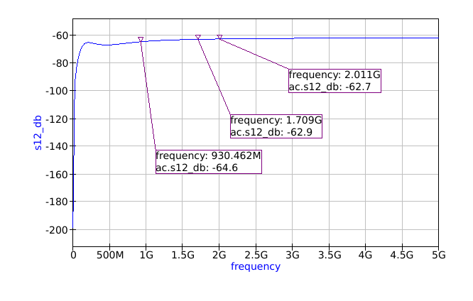|
|S21|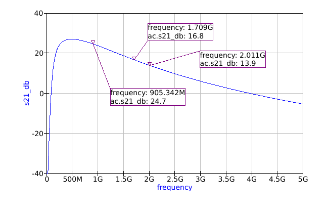|
|S22||
|Rollett Stability Factor|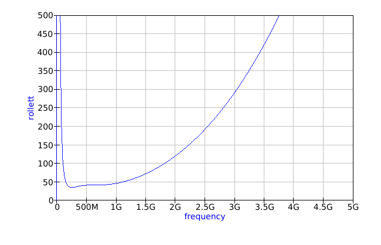|
|Mu Stability Factor|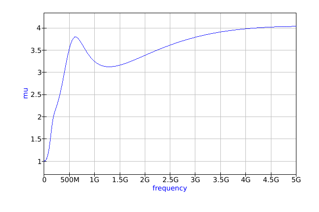|

## Compression Test Bench

*Most Up-To-Date Test Bench: Schematic/LNA/LNA_Layout_Testing_Compression_MkI.sch*

Gain compression testing was performed using a sweep of transient simulations, measuring the LNAs response to a tone at 1.7 GHz.  This gives the most accurate compression results.  Compression is clearly a weak spot for this design, sometimes compressing at output powers as low as -19 dBm.  This is one of the effects of degenerating the cascode drains in the middle gain stages to flatten the frequency response of the amplifier.  The degeneration limits the output power.

### Typical 
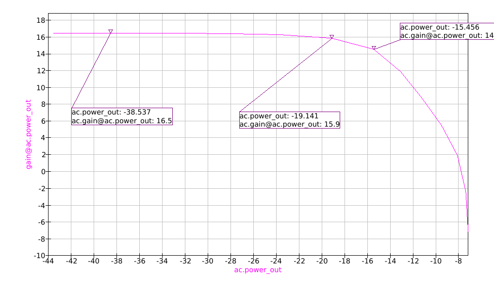

|Parameter|Value|
|---------|-----|
| OP1dB   | -17 dBm |

## Linearity Test Bench

*Most Up-To-Date Test Bench: Schematic/LNA/LNA_Layout_Testing_Linearity_MkI.sch*

Linearity of the amplifier was assessed using a standard two tone test characterizing third order intermodulation products at ~1.7 GHz.  The test was performed at two different power input levels, -20 dBm and -30 dBm.  Interestingly, higher input power seemed to improve linearity slightly.  Both of these power levels are significantly far away from the compression point of the amplifier, so there were not concerns of beginning to compress any stages of the amplifier.

The "CalculateOIP3.py" file was used to calculate the amplifier OIP3 from the extracted linearity. 

### Typical 
| Low Power (-30 dBm) | High Power (-20dBm) |
|---------------------|---------------------|
|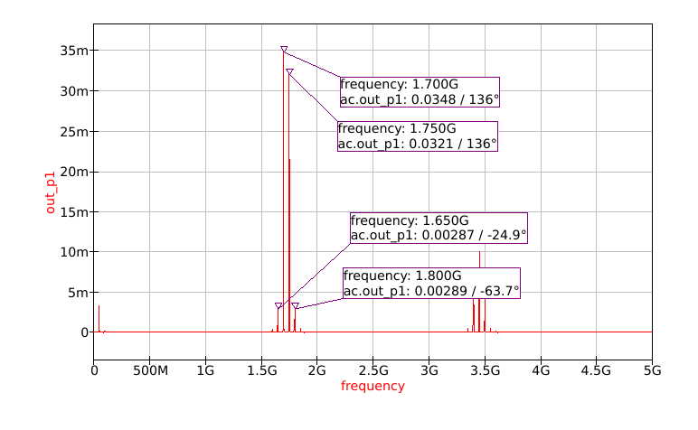|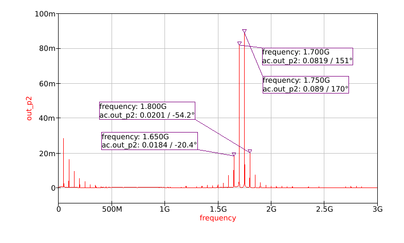|

*I think there is currently an error in this simulation.  Take the data with a grain of salt.*

#### Low Power (-30 dBm)
|Parameter|Value|
|---------|-----|
|Plow| -19.1 dBm |
|Phigh| -19.8 dBm |
|IM3low| -40.8 dBm |
|IM3high| -40.8 dBm |
|OIP3| -8.8 dBm |

#### High Power (-20 dBm)
|Parameter|Value|
|---------|-----|
|Plow| -11.7 dBm |
|Phigh| -11.0 dBm |
|IM3low| -24.9 dBm |
|IM3high| -24.7 dBm |
|OIP3| -4.6 dBm |

## DC Power Consumption Test Bench

*Most Up-To-Date Test Bench: Schematic/LNA/LNA_Layout_Testing_Power_MkI.sch*

The average and peak DC power consumption of the LNA was characterized when saturated with a 1.7GHz tone.

### Typical 
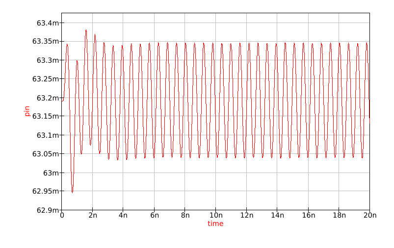

|Parameter|Value|
|---------|-----|
| Average DC Power Consumption   | 62 mW |
| Peak DC Power Consumption   | 63 mW |

## Supply Sweep Test Bench

*Most Up-To-Date Test Bench: Schematic/LNA/LNA_Layout_Testing_Power_MkI.sch*
The LNA voltage supply was sweeped between 2 and 4 volts.  As expected, the gain was positively correlated with operating voltage.  The thin oxide on the transistors will break down above 3.3V, but it is good to see the stability margins on the LNA at slightly higher voltage.  The amplifier remained stable across the entire voltage sweep at all corners, which was good.

### Typical 
| Maximum Gain (dB) | Minimum Rollett Stability Factor |
|---------------------|---------------------|
|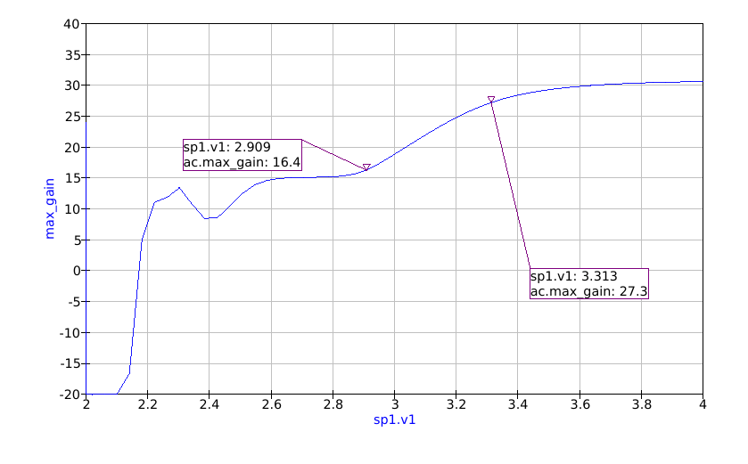|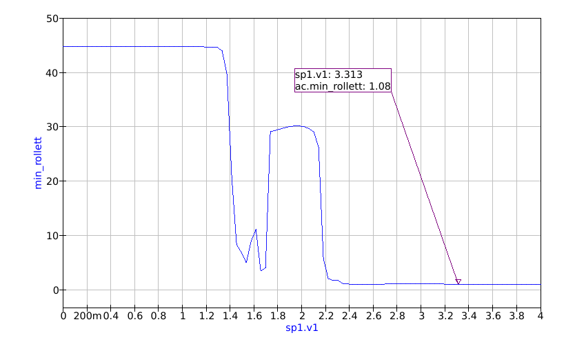|

## Temperature Test Bench

*Most Up-To-Date Test Bench: Schematic/LNA/LNA_Layout_Testing_Temp_MkI.sch*

Temperature was sweeped between between -25C and 125C, the automotive component temperature range.  The gain of the LNA fell off somewhat significantly after 80C, although it never stopped providing gain.  This was to be expected because this LNA does not have any temperature compensation (nor does it really have a way to implement that architecturally).  More importantly, the amplifier remained stable across the entire temperature sweep at all corners.

### Typical 
| Maximum Gain (dB) | Minimum Rollett Stability Factor |
|---------------------|---------------------|
|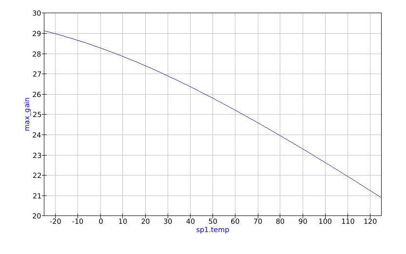|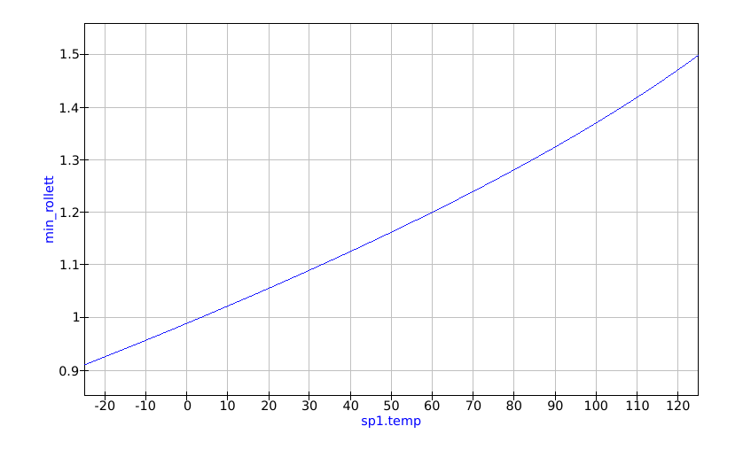|

