# Low Noise Amplifier Layout
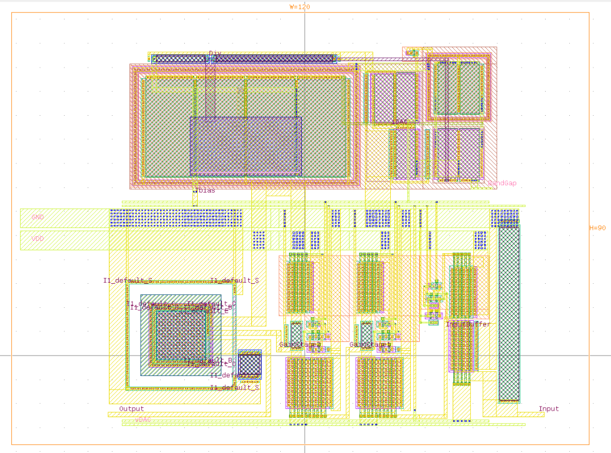

*LNA Layout GDS files available at: /Layout/LNA/LNAMkV.klay.gds*

Above is the layout for the L-Band LNA presented prior.  The simulation test results are available [here](/Layout/LNA/Simulations.md).

## Input Buffer
### Input Buffer Layout
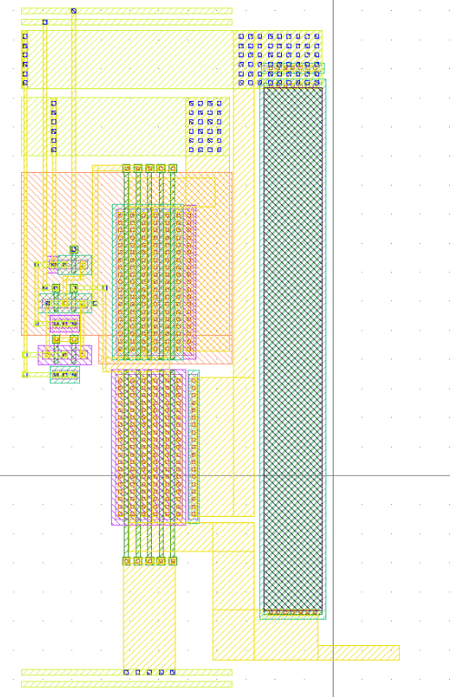

### Input Buffer Layout Driven Schematic
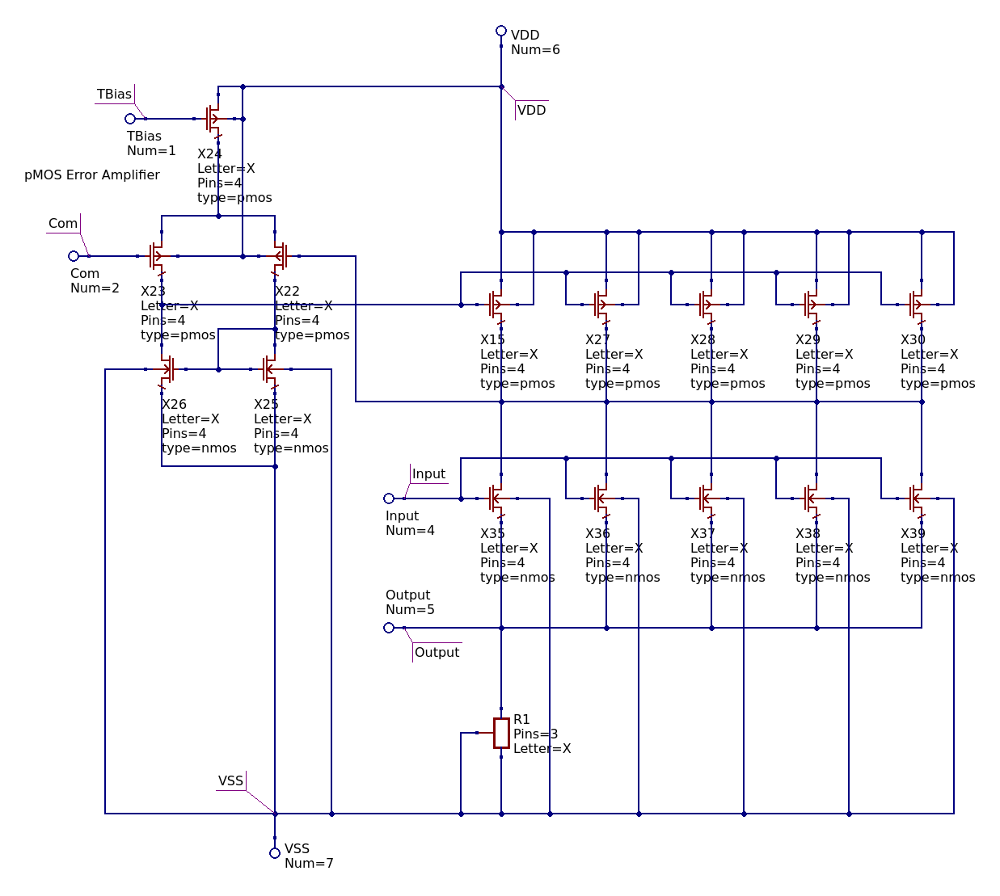
*The LVS schematic is available at: /Schematic/Input Buffer/InputBufferMkI_LVS.sch*

### Input Buffer LVS Results
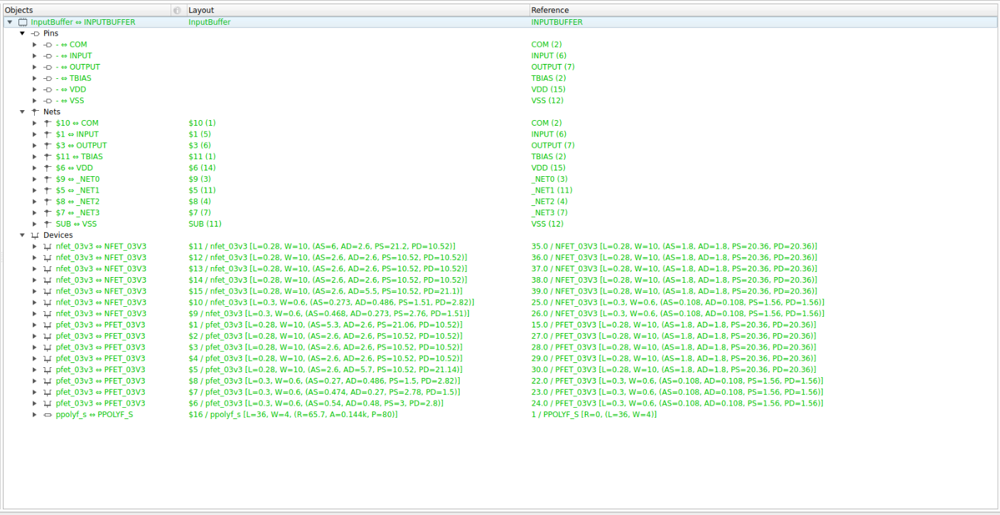

## Gain Stage
### Gain Stage Layout
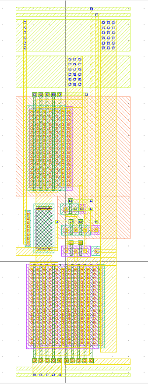

### Gain Stage Layout Driven Schematic
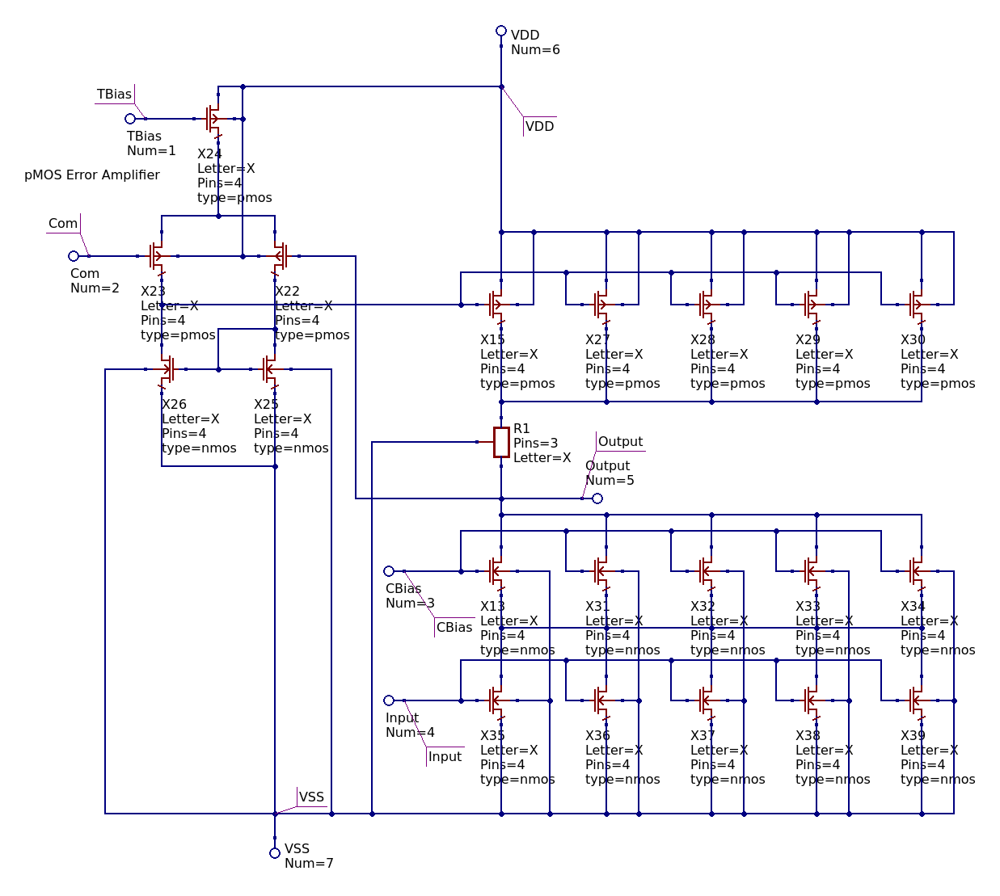
*The LVS schematic is available at: /Schematic/Gain Stage/GainStageMkII_LVS.sch*

### Gain Stage LVS Results
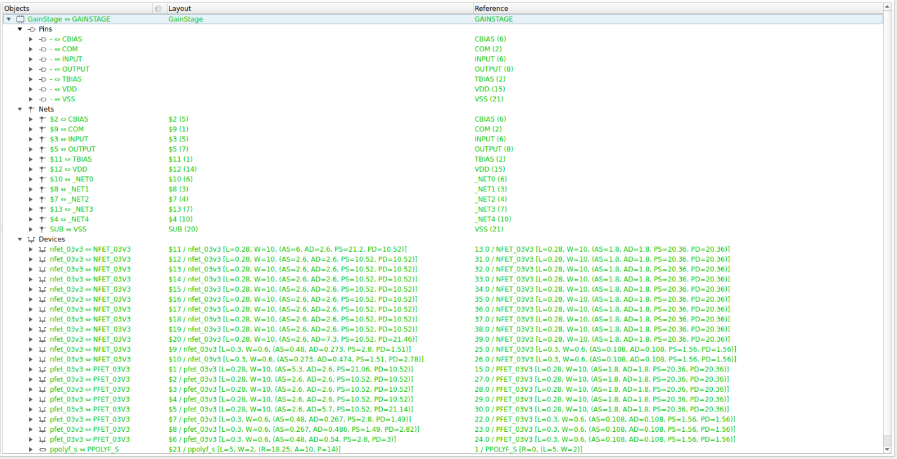

## Output Buffer
### Output Buffer Layout
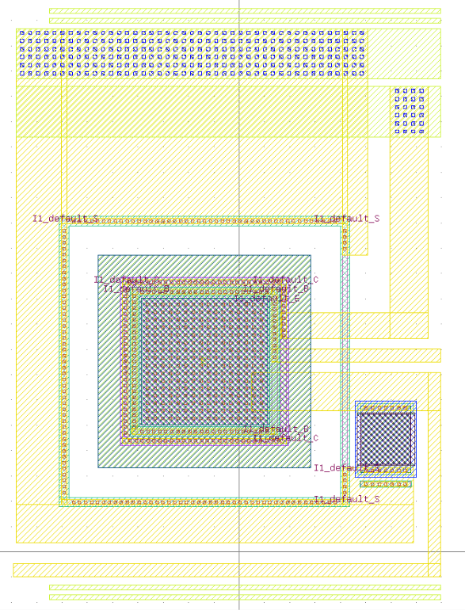

### Output Buffer Layout Driven Schematic
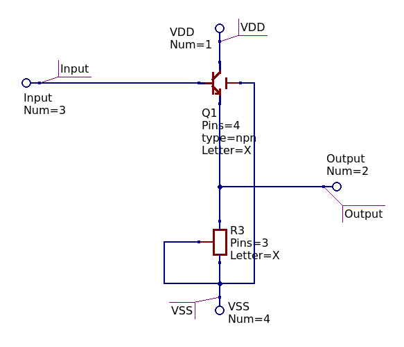
*The LVS schematic is available at: /Schematic/Output Buffer/OutputBufferMkVI_LVS.sch*

### Output Buffer LVS Results
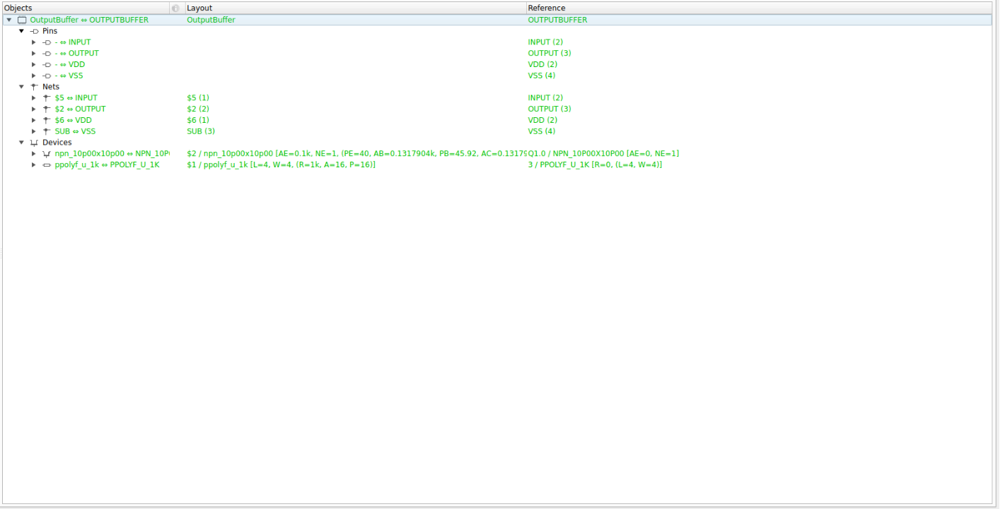

## Reference
### Reference Laypout
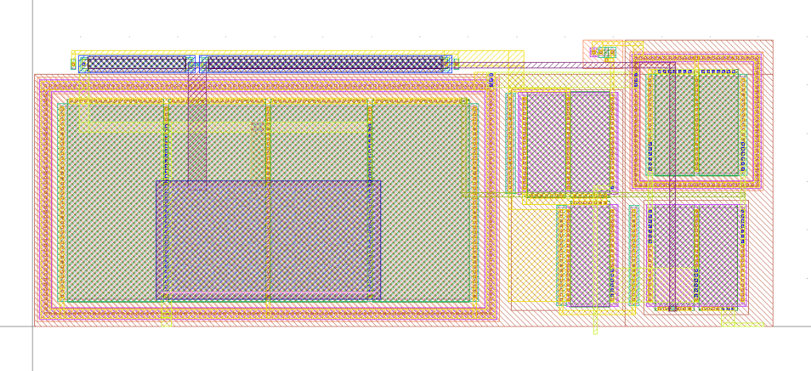

### Reference LVS Results
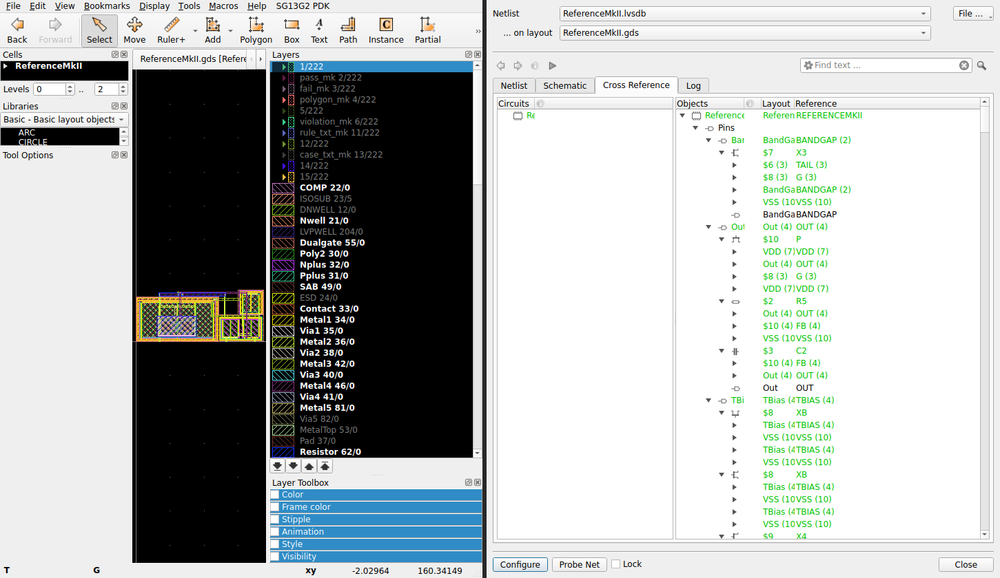

## Pad

